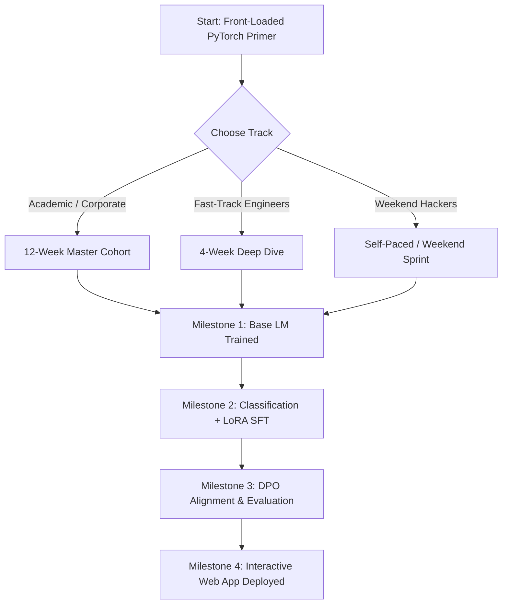

# 🗓️ StoryCraft-LLM: Project Roadmap & Execution Schedules

> **Building a Modern Large Language Model from First Principles**

This document provides learning paths, milestone checklists, hardware benchmarks, and dataset acquisition instructions for completing or teaching the **StoryCraft-LLM** course.

---

## ⏱️ Learning Tracks

Depending on your available time and background, choose one of the three recommended tracks:

### Track A: 12-Week Master Cohort (1 Module / Week)
*Best for university courses, corporate upskilling, and study groups.*

| Week | Focus Module | Core Milestone Deliverable |
| :---: | :--- | :--- |
| **Prerequisite** | [**PyTorch Primer**](pytorch_primer/) | Master tensor layouts, broadcasting, autograd DAG, and custom modules. |
| **Week 1** | **Module 00:** Foundations & Language Modeling | Build Bigram/Trigram story generator; document failure modes. |
| **Week 2** | **Module 01:** Tokenization & Data Pipelines | Train custom BPE tokenizer (4k vocab); build PyTorch data loader. |
| **Week 3** | **Module 02:** Vector Space & Positional Encodings | Implement Rotary Positional Embeddings (RoPE); visualize vectors. |
| **Week 4** | **Module 03:** Transformer Architecture from Scratch | Build MHA, RMSNorm, SwiGLU, and assemble full 8.5M model. |
| **Week 5** | **Module 04:** Pre-training Engine | Run pre-training loop with AdamW, cosine warmup, and `torch.compile`. |
| **Week 6** | **Module 05:** Generation, Sampling & Open Weights | Implement Top-k/Top-p; map state dicts from open foundation models. |
| **Week 7** | **Module 06:** Classification & Story Moderation | Attach classification head ($d \to K$); build Story Genre/Safety filter. |
| **Week 8** | **Module 07:** Instruction Tuning (SFT) & LoRA | Build ChatML formatter; implement pure PyTorch LoRA from scratch. |
| **Week 9** | **Module 08:** Alignment via DPO | Implement Direct Preference Optimization; align morals and endings. |
| **Week 10** | **Module 09:** Evaluation & LLM-as-a-Judge | Automated benchmark suite on 100 test prompts with Gemini/GPT rubric. |
| **Week 11** | **Module 10:** KV Cache & Optimization | Implement $O(1)$ KV Cache ($> 3.5\times$ TPS) and INT8 quantization. |
| **Week 12** | **Module 11:** Capstone Storybook Studio | Deploy interactive FastAPI + Web UI with streaming story generation. |

---

### Track B: 4-Week Fast-Track Bootcamp (Intensive)
*Best for experienced software engineers and data scientists.*

* **Prerequisite (Tensor Mechanics):** [PyTorch Primer](pytorch_primer/) (Tensors, strides, Autograd DAG, nn.Module)
* **Week 1 (Architecture & Data):** Modules 00, 01, 02, 03  
  *Deliverable:* Complete PyTorch model forward pass verified on dummy inputs.
* **Week 2 (Pre-training, Sampling & Weights):** Modules 04, 05  
  *Deliverable:* Base pre-trained model capable of generating fluent tiny stories.
* **Week 3 (Post-Training, Classification & LoRA):** Modules 06, 07, 08  
  *Deliverable:* Story classifier, LoRA adapter fine-tuning, and DPO alignment.
* **Week 4 (Inference, Benchmarking & Deployment):** Modules 09, 10, 11  
  *Deliverable:* KV Caching optimization, LLM-as-a-judge report, and live Web UI running locally.

---

## 📊 Model Architecture Specifications

Our default reference architecture is optimized for fast training on consumer hardware while matching modern state-of-the-art designs (LLaMA / Mistral architecture style):

| Hyperparameter | Value | Notes |
| :--- | :--- | :--- |
| **Vocabulary Size ($V$)** | `4,096` | Custom BPE trained on TinyStories |
| **Hidden Dimension ($d_{\text{model}}$)** | `256` | Balances expressivity with low memory |
| **Number of Layers ($n_{\text{layers}}$)** | `6` | Sufficient depth for narrative syntax |
| **Attention Heads ($n_{\text{heads}}$)** | `8` | Head dimension $d_k = 32$ |
| **Context Length ($T_{\text{max}}$)** | `256` | Fits 95% of children's stories in TinyStories |
| **Feed-Forward Hidden Dim** | `688` | Standard $\approx \frac{8}{3} d_{\text{model}}$ SwiGLU ratio |
| **Positional Encoding** | Rotary (RoPE) | Modern relative position mechanism |
| **Normalization** | RMSNorm ($\epsilon = 10^{-5}$) | Faster and more stable than standard LayerNorm |
| **Activation Function** | SwiGLU | Superior gradient flow over traditional ReLU/GELU |
| **Total Parameter Count** | **~8,470,000** | Fits comfortably in any modern RAM/VRAM |

---

## 🖥️ Benchmark & Hardware Matrix

Expected training speeds for **100,000 stories (~10M tokens)**:

| Hardware | Accelerator | Precision | Batch Size | Time to PPL $< 4.5$ |
| :--- | :--- | :--- | :--- | :--- |
| **Apple MacBook Air (M1/M2/M3, 8GB-16GB)** | MPS | `float32` / `float16` | 32 | **~40–50 mins** |
| **Apple MacBook Pro (M2/M3/M4 Max/Pro)** | MPS | `float16` | 64 | **~20–25 mins** |
| **NVIDIA GeForce RTX 3060 / 4060** | CUDA | `bfloat16` | 64 | **~18–22 mins** |
| **NVIDIA A100 / H100 (Cloud)** | CUDA | `bfloat16` | 256 | **~4–6 mins** |
| **Standard Multi-core CPU** | CPU (AVX2) | `float32` | 8 | **~2.5 hours** |

---

## ✅ Instructor & Learner Milestone Verification Checklist

- [ ] **Prerequisite Milestone:** Complete PyTorch Primer; verify memory strides, broadcasting, and autograd DAG in `pytorch_primer/tests.py`.
- [ ] **Milestone 00:** Understand N-gram probabilities and observe failure modes on story text.
- [ ] **Milestone 01:** Build BPE tokenizer; verify roundtrip `decode(encode(text)) == text`.
- [ ] **Milestone 02:** Implement RoPE; verify query-key dot product invariance to relative shift.
- [ ] **Milestone 03:** Build `StoryCraftLM` in PyTorch; verify forward pass shapes with causal mask.
- [ ] **Milestone 04:** Run pre-training loop; reach validation perplexity $< 4.5$.
- [ ] **Milestone 05:** Build sampling CLI; map state dict from an open model into scratch architecture.
- [ ] **Milestone 06:** Attach classification head ($d \to K$); train Story Genre/Safety classifier.
- [ ] **Milestone 07:** Implement LoRA from scratch; fine-tune with ChatML prompt masking.
- [ ] **Milestone 08:** Run DPO alignment; verify model chooses kind/safe story resolutions.
- [ ] **Milestone 09:** Benchmark model with automated perplexity and LLM-as-a-judge rubrics.
- [ ] **Milestone 10:** Implement KV Cache; achieve $> 3.5\times$ speedup on autoregressive token streaming.
- [ ] **Milestone 11:** Launch the full-stack StoryCraft Studio web application.
