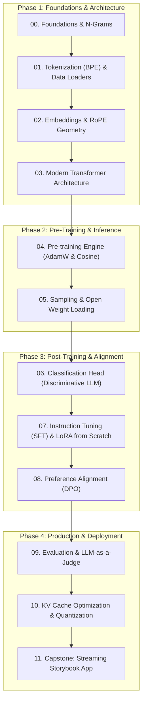

# 🚀 LLM-From-First-Principles: Building a Large Language Model from Scratch

[](https://pytorch.org/)
[](https://opensource.org/licenses/MIT)
[]()

> A complete, first-principles curriculum for understanding, building, training, fine-tuning, aligning, and deploying a modern Large Language Model—anchored entirely on a single unifying project: **The Tiny Story Generator ("StoryCraft-LLM")**.  
> *Enhanced with architecture patterns and production engineering techniques from Sebastian Raschka's `LLMs-from-scratch`.*

---

## 💡 The Big Idea

How do modern LLMs (like GPT-4, LLaMA 3, Claude, and Gemini) really work under the hood?

Instead of treating LLMs as mysterious black boxes or downloading bloated libraries, this course teaches you how to construct an entire modern LLM from absolute first principles using pure Python and PyTorch.

To make the learning concrete, intuitive, and fun, every single concept is applied to one central mission:

```
+---------------------------------------------------------------------------------------+
|                              THE STORYCRAFT-LLM MISSION                               |
|                                                                                       |
|   Build an AI Storyteller that invents charming, coherent, grammatically sound        |
|   children's stories on demand—learning from raw text up to chat alignment.           |
+---------------------------------------------------------------------------------------+
```

Because our domain is constrained to synthetic children's stories (vocabulary of ~3,000–4,000 words), our model needs only **~8.5 Million parameters**. This means:
- **Zero expensive GPU clusters needed:** Trains on your MacBook (M1/M2/M3/M4) or free Google Colab in **30–45 minutes**.
- **Intuitive progress:** You can immediately judge output quality by reading the stories at each step.
- **Production-grade architecture:** We build a state-of-the-art decoder-only model matching modern LLaMA architectures (RoPE positional embeddings, RMSNorm, SwiGLU activations, Causal Multi-Head Attention, DPO alignment, LoRA from scratch, and KV-caching).

---

## 🗺️ High-Level Course Architecture



---

## 📚 Curriculum Navigation

| Module | Topic | Core Question Answered | Deliverable |
| :---: | :--- | :--- | :--- |
| [**Module 00**](modules/00_foundations/) | **Foundations & N-Grams** | *What does it mean to model language mathematically?* | Bigram/Trigram story baseline + failure analysis |
| [**Module 01**](modules/01_tokenization/) | **Tokenization & Data Pipelines** | *How do machines convert raw text into numerical tokens?* | Custom 4k BPE Tokenizer + PyTorch DataLoader |
| [**Module 02**](modules/02_embeddings/) | **Embeddings & RoPE** | *How do words get meaning and order in vector space?* | Continuous vector spaces + RoPE implementation |
| [**Module 03**](modules/03_transformer_architecture/) | **The Transformer Architecture** | *How do Query, Key, and Value build dynamic attention?* | Complete modern `StoryCraftLM` in PyTorch (~200 lines) |
| [**Module 04**](modules/04_pretraining/) | **Pre-training Engine** | *How does a model learn from millions of tokens?* | AdamW loop, Cosine warmup, `torch.compile`, `storycraft_base.pt` |
| [**Module 05**](modules/05_generation_sampling/) | **Generation, Sampling & Weights** | *How do we sample creatively and load open weights?* | Sampling CLI + State-Dict mapper for open models |
| [**Module 06**](modules/06_classification/) | **Discriminative LLMs: Classification** | *How do we adapt an LLM for classification & moderation?* | Story Genre, Safety & Age Classifier ($d \to K$) |
| [**Module 07**](modules/07_instruction_tuning_sft/) | **Instruction Tuning & LoRA** | *How do we fine-tune efficiently without retraining everything?* | ChatML prompt masking + pure PyTorch LoRA ($r=4$) |
| [**Module 08**](modules/08_alignment_dpo/) | **Alignment via DPO** | *How do we teach the model morals, safety, and happy endings?* | Direct Preference Optimization (DPO) pipeline |
| [**Module 09**](modules/09_evaluation/) | **Evaluation & Benchmarks** | *How do we objectively measure model intelligence and safety?* | Automated PPL + LLM-as-a-judge scoring suite |
| [**Module 10**](modules/10_kv_cache_optimization/) | **KV Caching & Optimization** | *Why is inference quadratic, and how do we speed it up?* | $O(1)$ KV Cache ($> 3.5\times$ TPS) + INT8 quantization |
| [**Module 11**](modules/11_capstone_storybook_app/) | **Capstone Storybook App** | *How do we deploy a real-time AI product?* | Streaming FastAPI backend + interactive Web UI |

### 🔬 Advanced Appendices
- [**Appendix A: PyTorch Primer & Distributed Data Parallel (DDP)**](appendices/appendix_a_pytorch_ddp/)
- [**Appendix B: Frontier Attention Architectures (GQA, MLA, MoE)**](appendices/appendix_b_gqa_moe/)
- [**Appendix C: Cross-Architecture Weight Importers (SmolLM / LLaMA / GPT-2)**](appendices/appendix_c_weight_loading/)
- [**Appendix D: Training Speedups (FlashAttention, `torch.compile`, Muon)**](appendices/appendix_d_speed_compilation/)

👉 **Read the comprehensive master syllabus:** [COURSE_CURRICULUM.md](COURSE_CURRICULUM.md)  
👉 **Check learning schedules & timelines:** [PROJECT_ROADMAP.md](PROJECT_ROADMAP.md)

---

## 🏗️ The StoryCraft-LLM Architecture Specs

The model built throughout this course adopts the modern architecture shared by **LLaMA 3**, **Mistral**, and **Gemma**:

- **Model Type:** Decoder-Only Causal Transformer
- **Parameters:** ~8.5 Million
- **Vocabulary:** 4,096 tokens (BPE)
- **Context Window:** 256 tokens
- **Layers:** 6 Transformer Blocks
- **Hidden Dim ($d_{\text{model}}$):** 256
- **Heads ($n_{\text{heads}}$):** 8 (Head dim = 32)
- **Feed-Forward:** SwiGLU (Hidden dim = 688)
- **Positional Embeddings:** Rotary Position Embeddings (RoPE)
- **Normalization:** RMSNorm ($\epsilon = 10^{-5}$)
- **Weight Tying:** Output LM head tied to input embeddings for parameter efficiency

---

## ⚡ Quickstart: Setting Up the Environment

### 1. Set Up Virtual Environment
```bash
python3 -m venv venv
source venv/bin/activate
pip install -r requirements.txt
```

### 2. Verify Hardware Acceleration
```bash
python -c "import torch; print('CUDA Available:', torch.cuda.is_available()); print('MPS (Apple Silicon) Available:', torch.backends.mps.is_available())"
```

### 3. Download the Training Stories
```bash
python data/download_tinystories.py --num_samples 100000
```
