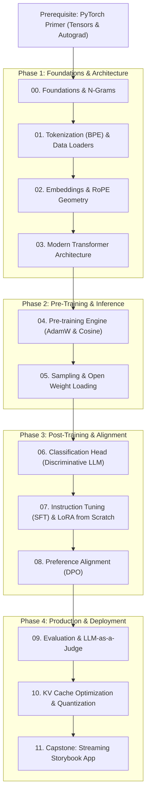

# 🚀 StoryCraft-LLM: Building a Modern Large Language Model from First Principles

[](https://pytorch.org/)
[](https://opensource.org/licenses/MIT)
[]()

> A complete, first-principles curriculum for understanding, building, training, fine-tuning, aligning, and deploying a modern Large Language Model—anchored entirely on a single unifying project: **The Tiny Story Generator ("StoryCraft-LLM")**.  
> *Enhanced with architecture patterns and production engineering techniques from Sebastian Raschka's `LLMs-from-scratch`.*

---

## 💡 The Big Idea

How do modern LLMs (like GPT-4, LLaMA 3, Claude, and Gemini) really work under the hood?

Instead of treating LLMs as mysterious black boxes or downloading bloated libraries, this course teaches you how to construct an entire modern LLM from absolute first principles using pure Python and PyTorch.

To make the learning concrete, intuitive, and fun, every single concept is applied to one central mission:

```
+---------------------------------------------------------------------------------------+
|                              THE STORYCRAFT-LLM MISSION                               |
|                                                                                       |
|   Build an AI Storyteller that invents charming, coherent, grammatically sound        |
|   children's stories on demand—learning from raw text up to chat alignment.           |
+---------------------------------------------------------------------------------------+
```

Because our domain is constrained to synthetic children's stories (vocabulary of ~3,000–4,000 words), our model needs only **~8.5 Million parameters**. This means:
- **Zero expensive GPU clusters needed:** Trains on your MacBook (M1/M2/M3/M4) or free Google Colab in **30–45 minutes**.
- **Intuitive progress:** You can immediately judge output quality by reading the stories at each step.
- **Production-grade architecture:** We build a state-of-the-art decoder-only model matching modern LLaMA architectures (RoPE positional embeddings, RMSNorm, SwiGLU activations, Causal Multi-Head Attention, DPO alignment, LoRA from scratch, and KV-caching).

---

## 🗺️ High-Level Course Architecture



---

## 📚 Curriculum Navigation

| Module | Topic | Core Question Answered | Run Command | Deliverable |
| :---: | :--- | :--- | :--- | :--- |
| [**PyTorch Primer**](pytorch_primer/) | **PyTorch Primer: Tensors & Autograd** | *How do tensors, strides, autograd, and parameters work?* | `python3 pytorch_primer/demo_pytorch_primer.py` | Tensor mechanics, zero-copy views, autograd DAG |
| [**Module 00**](modules/00_foundations/) | **Foundations & N-Grams** | *What does it mean to model language mathematically?* | `python3 modules/00_foundations/demo_foundations.py` | Bigram/Trigram story baseline + failure analysis |
| [**Module 01**](modules/01_tokenization/) | **Tokenization & Data Pipelines** | *How do machines convert raw text into numerical tokens?* | `python3 modules/01_tokenization/demo_tokenization.py` | Custom 4k BPE Tokenizer + PyTorch DataLoader |
| [**Module 02**](modules/02_embeddings/) | **Embeddings & RoPE** | *How do words get meaning and order in vector space?* | `python3 modules/02_embeddings/demo_embeddings_rope.py` | Continuous vector spaces + RoPE implementation |
| [**Module 03**](modules/03_transformer_architecture/) | **The Transformer Architecture** | *How do Query, Key, and Value build dynamic attention?* | `python3 modules/03_transformer_architecture/demo_transformer_architecture.py` | Complete modern `StoryCraftLM` in PyTorch (~200 lines) |
| [**Module 04**](modules/04_pretraining/) | **Pre-training Engine** | *How does a model learn from millions of tokens?* | `python3 modules/04_pretraining/demo_pretraining_engine.py` | AdamW loop, Cosine warmup, `torch.compile`, `train.py` |
| [**Module 05**](modules/05_generation_sampling/) | **Generation, Sampling & Weights** | *How do we sample creatively and load open weights?* | `python3 modules/05_generation_sampling/demo_generation_sampling.py` | Sampling CLI + State-Dict mapper for open models |
| [**Module 06**](modules/06_classification/) | **Discriminative LLMs: Classification** | *How do we adapt an LLM for classification & moderation?* | `python3 modules/06_classification/demo_story_classifier.py` | Story Genre, Safety & Age Classifier ($d \to K$) |
| [**Module 07**](modules/07_instruction_tuning_sft/) | **Instruction Tuning & LoRA** | *How do we fine-tune efficiently without retraining everything?* | `python3 modules/07_instruction_tuning_sft/demo_sft_lora.py` | ChatML prompt masking + pure PyTorch LoRA ($r=4$) |
| [**Module 08**](modules/08_alignment_dpo/) | **Alignment via DPO** | *How do we teach the model morals, safety, and happy endings?* | `python3 modules/08_alignment_dpo/demo_alignment_dpo.py` | Direct Preference Optimization (DPO) pipeline |
| [**Module 09**](modules/09_evaluation/) | **Evaluation & Benchmarks** | *How do we objectively measure model intelligence and safety?* | `python3 modules/09_evaluation/demo_evaluation_benchmarks.py` | Automated PPL + LLM-as-a-judge scoring suite |
| [**Module 10**](modules/10_kv_cache_optimization/) | **KV Caching & Optimization** | *Why is inference quadratic, and how do we speed it up?* | `python3 modules/10_kv_cache_optimization/demo_kv_cache.py` | $O(1)$ KV Cache ($> 3.5\times$ TPS) + INT8 quantization |
| [**Module 11**](modules/11_capstone_storybook_app/) | **Capstone Storybook App** | *How do we deploy a real-time AI product?* | `python3 modules/11_capstone_storybook_app/demo_capstone_app.py` | Streaming FastAPI backend + interactive Web UI |

### 🔬 Advanced Appendices
- [**Appendix A: Distributed Data Parallel (DDP) & Multi-GPU Training**](appendices/appendix_a_pytorch_ddp/) (`python3 appendices/appendix_a_pytorch_ddp/demo_pytorch_ddp.py`)
- [**Appendix B: Frontier Attention Architectures (GQA, MLA, MoE)**](appendices/appendix_b_gqa_moe/) (`python3 appendices/appendix_b_gqa_moe/demo_gqa_moe.py`)
- [**Appendix C: Cross-Architecture Weight Importers (SmolLM / LLaMA / GPT-2)**](appendices/appendix_c_weight_loading/) (`python3 appendices/appendix_c_weight_loading/demo_weight_loading.py`)
- [**Appendix D: Training Speedups (FlashAttention, `torch.compile`, Muon)**](appendices/appendix_d_speed_compilation/) (`python3 appendices/appendix_d_speed_compilation/demo_speed_compilation.py`)

👉 **Read the comprehensive master syllabus:** [COURSE_CURRICULUM.md](COURSE_CURRICULUM.md)  
👉 **Check learning schedules & timelines:** [PROJECT_ROADMAP.md](PROJECT_ROADMAP.md)

---

## 🏗️ The StoryCraft-LLM Architecture Specs

The model built throughout this course adopts the modern architecture shared by **LLaMA 3**, **Mistral**, and **Gemma**:

- **Model Type:** Decoder-Only Causal Transformer
- **Parameters:** ~8.5 Million
- **Vocabulary:** 4,096 tokens (BPE)
- **Context Window:** 256 tokens
- **Layers:** 6 Transformer Blocks
- **Hidden Dim ($d_{\text{model}}$):** 256
- **Heads ($n_{\text{heads}}$):** 8 (Head dim = 32)
- **Feed-Forward:** SwiGLU (Hidden dim = 688)
- **Positional Embeddings:** Rotary Position Embeddings (RoPE)
- **Normalization:** RMSNorm ($\epsilon = 10^{-5}$)
- **Weight Tying:** Output LM head tied to input embeddings for parameter efficiency

---

## ⚡ Quickstart: Setting Up the Environment

### 1. Set Up Virtual Environment
```bash
python3 -m venv venv
source venv/bin/activate
pip install -r requirements.txt
```

### 2. Verify Hardware Acceleration
```bash
python -c "import torch; print('CUDA Available:', torch.cuda.is_available()); print('MPS (Apple Silicon) Available:', torch.backends.mps.is_available())"
```

### 3. Download the Training Stories
```bash
python data/download_tinystories.py --num_samples 100000
```

---

## 🎮 Essential Commands Quick Reference

### 1. Interactive Story Generation (Capstone App)
Run the deployed, streaming story generation application:
```bash
# Run the complete interactive storybook app (typewriter streaming, branching, UI controls)
python3 modules/11_capstone_storybook_app/demo_capstone_app.py

# Generate a story on-demand from a custom prompt (Aligned Model)
python3 modules/11_capstone_storybook_app/demo_capstone_app.py --prompt "Barnaby the puppy ran through the meadow"

# Test raw story completion directly on the Base Model (Module 04 weights)
python3 modules/11_capstone_storybook_app/demo_capstone_app.py --model base --prompt "Once upon a time Lily"
```

### 2. Full Training & Alignment Pipeline (Zero to Aligned LLM)
Run the complete end-to-end training lifecycle across persistent checkpoints:
```bash
# Step 1: Pre-train the base model on TinyStories (Module 04 -> checkpoints/storycraft_base.pt)
python3 modules/04_pretraining/train.py --max_steps 2000 --batch_size 16 --save

# Step 2: Fine-tune instruction-following with LoRA (Module 07 -> checkpoints/storycraft_instruct.pt)
python3 modules/07_instruction_tuning_sft/demo_sft_lora.py

# Step 3: Align values with Direct Preference Optimization (Module 08 -> checkpoints/storycraft_aligned.pt)
python3 modules/08_alignment_dpo/demo_alignment_dpo.py

# Step 4: Benchmark low-latency KV-Cache inference speedup (Module 10)
python3 modules/10_kv_cache_optimization/demo_kv_cache.py
```

### 3. Module-by-Module Demonstration Suite
Run any individual module's interactive first-principles demo:
```bash
# Prerequisite: PyTorch Primer (Tensors, Strides, Autograd, nn.Module)
python3 pytorch_primer/demo_pytorch_primer.py

# Module 00: Language Modeling Foundations & N-Grams
python3 modules/00_foundations/demo_foundations.py

# Module 01: Byte-Pair Encoding (BPE) Tokenization & Data Pipelines
python3 modules/01_tokenization/demo_tokenization.py

# Module 02: Embedding Vector Spaces & Rotary Position Embeddings (RoPE)
python3 modules/02_embeddings/demo_embeddings_rope.py

# Module 03: Modern Decoder Transformer Architecture (RMSNorm & SwiGLU)
python3 modules/03_transformer_architecture/demo_transformer_architecture.py

# Module 04: Pre-training Engine (Cosine warmup, AdamW & Perplexity)
python3 modules/04_pretraining/demo_pretraining_engine.py

# Module 05: Creative Sampling (Temperature, Top-k, Top-p & Repetition Penalty)
python3 modules/05_generation_sampling/demo_generation_sampling.py

# Module 06: Discriminative Story Classification & Content Moderation
python3 modules/06_classification/demo_story_classifier.py

# Module 07: Instruction Tuning (SFT) & LoRA from Scratch
python3 modules/07_instruction_tuning_sft/demo_sft_lora.py

# Module 08: Direct Preference Optimization (DPO) Value Alignment
python3 modules/08_alignment_dpo/demo_alignment_dpo.py

# Module 09: Automated Evaluation & LLM-as-a-Judge Benchmarks
python3 modules/09_evaluation/demo_evaluation_benchmarks.py

# Module 10: O(1) Key-Value (KV) Cache Latency Optimization
python3 modules/10_kv_cache_optimization/demo_kv_cache.py

# Module 11: Production Capstone Streaming Storybook Studio
python3 modules/11_capstone_storybook_app/demo_capstone_app.py
```

### 4. Advanced Appendices Demos
```bash
# Appendix A: Distributed Data Parallel (DDP) Multi-GPU Simulation
python3 appendices/appendix_a_pytorch_ddp/demo_pytorch_ddp.py

# Appendix B: Frontier Attention Architectures (GQA, MLA, MoE)
python3 appendices/appendix_b_gqa_moe/demo_gqa_moe.py

# Appendix C: Cross-Architecture Open-Weight Importers (GPT-2, SmolLM)
python3 appendices/appendix_c_weight_loading/demo_weight_loading.py

# Appendix D: Training Speedups (FlashAttention, torch.compile, Muon)
python3 appendices/appendix_d_speed_compilation/demo_speed_compilation.py
```

### 5. Automated Verification & Test Suites
Run all 13 unit test suites across all modules and primer to verify 100% test passing:
```bash
for f in modules/*/tests.py pytorch_primer/tests.py; do echo "=== Running $f ==="; python3 "$f"; done
```
